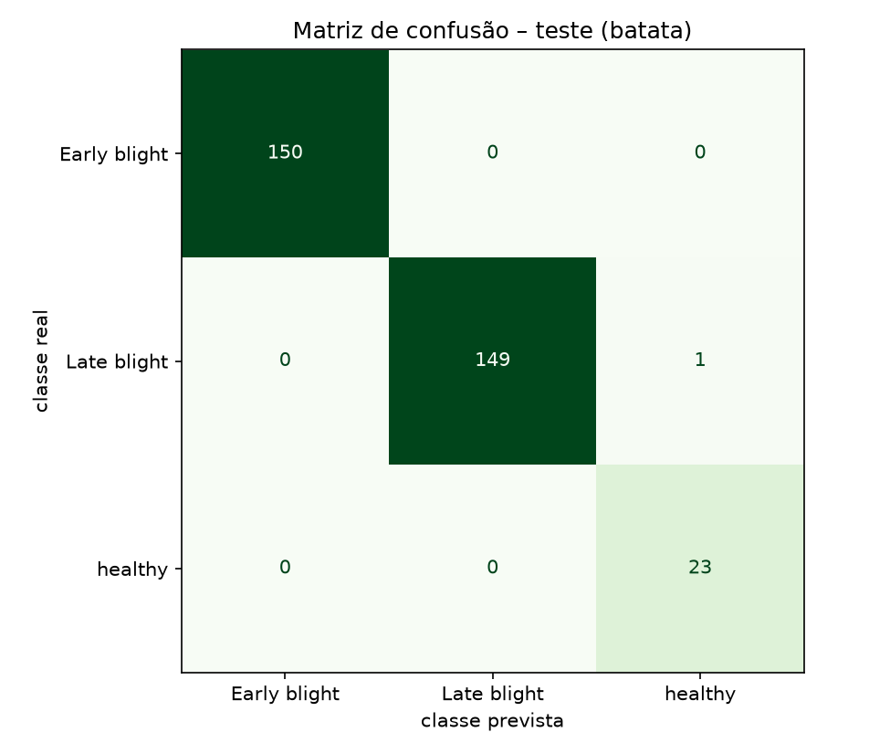
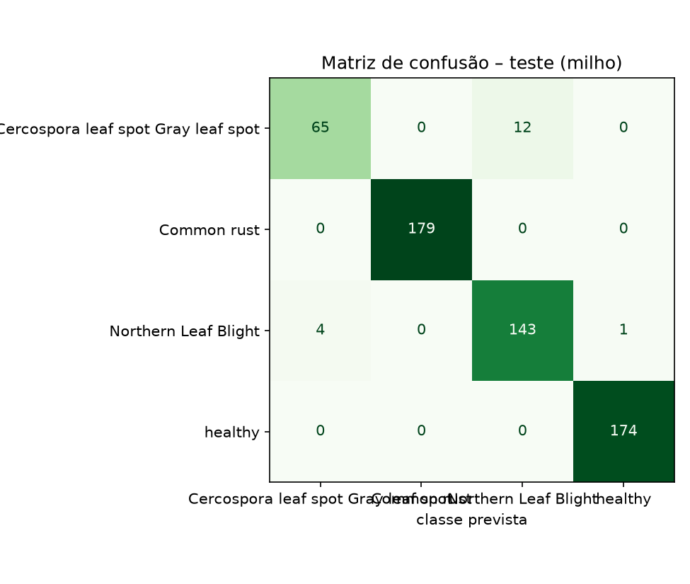
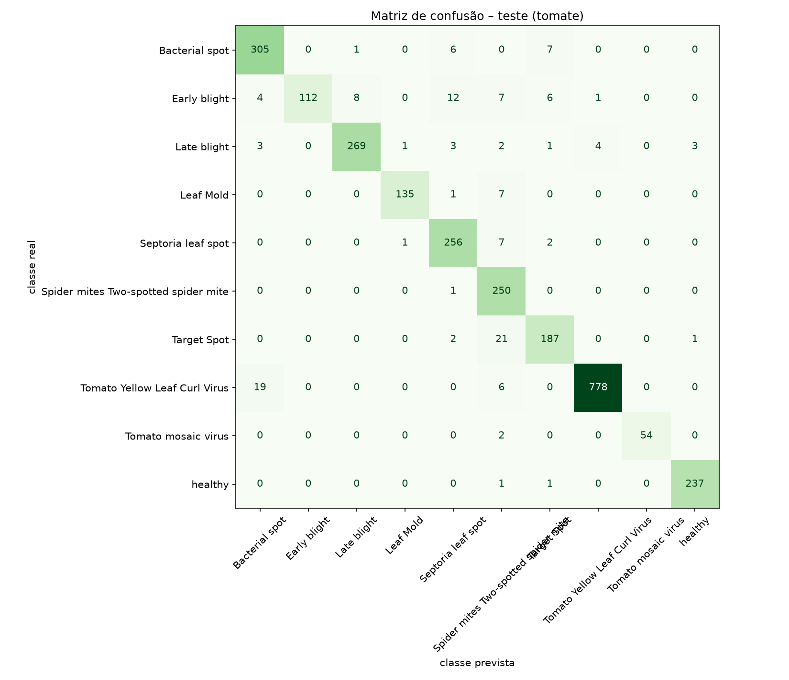

# PjBL2 – Classificadores de doenças de folhas (batata, milho e tomate)

Entrega do PjBL2 (Sistemas de Informação Inteligentes, PUCPR): um modelo de visão computacional com **≥ 3 categorias**, protocolo **treino/validação/teste**, **matriz de confusão** e métricas de classificação.
- A **batata** (3 classes) é a entrega principal.
- **Milho** (4 classes) e **tomate** (10 classes) seguem exatamente o mesmo procedimento (Quadros 1 e 3 do plano de projeto).

## 0. Onde está cada coisa (e como isto se relaciona com o notebook do Ítalo)
| Arquivo | Papel |
|---|---|
| `notebooks/01_treino_culturas.ipynb` + `notebooks/gerar_notebook.py` | **Notebook principal de treino da equipe** (Ítalo), para o Google Colab, com as 3 culturas. Não foi alterado. |
| `notebooks/execucao/{batata,milho,tomate}.ipynb` | **Execuções reais**, com saídas salvas, que **geraram os modelos e as métricas versionados em `modelos/`**. Foram executados ponta a ponta em CPU. São gerados por `notebooks/execucao/gerar_notebooks.py`. |
| `scripts/baixar_dados.sh` | Baixa o PlantVillage `color` (commit fixo) das 3 plantas. |
| `scripts/preparar_dados.py` | Divisão 70/15/15 (semente 42) por planta. Também gera `modelos/<planta>.classes.json`. |
| `dados/splits/<planta>/` | Listas fixas de treino, validação e teste (CSV) e as contagens. |
| `modelos/<planta>.onnx` | Modelos finais (saída = logits), no formato lido por `app/inferencia.py`. |
| `modelos/<planta>.classes.json` | `{"classes": [...]}` na ordem das saídas. É lido por `app/inferencia.py`. |
| `modelos/metricas_<planta>.json` | Métricas de teste, matriz, limiar calibrado, hiperparâmetros e histórico por época. |
| `modelos/matriz_confusao_<planta>.png`, `modelos/curvas_treino_<planta>.png` | Figuras. |

**Os dois notebooks seguem o mesmo protocolo:** PlantVillage `color`, ordem alfabética (`sorted`) das classes, divisão estratificada 70/15/15 com `seed=42`, MobileNetV2 da ImageNet em 2 fases, pesos de classe, aumento de dados só no treino e exportação ONNX com `input`/`logits`.

Diferenças das execuções em `notebooks/execucao/`:
- A divisão sai de listas CSV fixas, e duplicatas exatas (MD5) ficam no mesmo conjunto.
- O ajuste fino abrange só os últimos 5 blocos.
- O limiar é calibrado na validação.
- O treino do tomate tem um limite de imagens por classe (ver §3).

O notebook do Ítalo pode ser rodado no Colab para conferência. Os números deste documento vêm de `notebooks/execucao/`.

## 1. Base de imagens
- **Fonte:** PlantVillage (Hughes; Salathé, 2015), <https://github.com/spMohanty/PlantVillage-Dataset>, pasta `raw/color` (commit `7f7ecc7`).
- Usamos só a pasta `color` (imagens de 256×256 px). `grayscale` e `segmented` são versões das mesmas folhas.
- As imagens **não são versionadas**: estão no `.gitignore` e são baixadas por `bash scripts/baixar_dados.sh`.

| Planta | Classes | Imagens | Desbalanceamento |
|---|---|---|---|
| Batata | 3 | 2.152 | healthy: 152; doenças: 1.000 cada |
| Milho | 4 | 3.852 | 513 (cercosporiose) a 1.192 (ferrugem) |
| Tomate | 10 | 18.160 | 373 (mosaico) a 5.357 (TYLCV); 14 pares de imagens idênticas, mantidos juntos |

## 2. Protocolo experimental (igual para as 3 plantas)
- A divisão é **estratificada 70/15/15**, com **semente 42**, feita **por planta** e **antes** do aumento de dados.
- Imagens idênticas (mesmo MD5) ficam no mesmo conjunto.
- **Treino** ajusta os pesos. **Validação** escolhe a melhor época (maior F1 macro) e calibra o limiar. **Teste** é usado **uma única vez**, no final, com **todas** as imagens de teste.

| Planta | Treino (divisão) | Treino usado | Validação | Teste |
|---|---|---|---|---|
| Batata | 1.506 | 1.506 | 323 | 323 |
| Milho | 2.696 | 2.696 | 578 | 578 |
| Tomate | 12.712 | **7.227** (máx. 800/classe) | 2.724 | 2.724 |

## 3. Modelo e hiperparâmetros (iguais para as 3 plantas)
- **Arquitetura:** MobileNetV2 com pesos da ImageNet. A última camada vira `Dropout(0.2)` e `Linear(1280 → nº de classes)`.
- **Etapa 1:** backbone congelado, 6 épocas, Adam com lr 1e-3.
- **Etapa 2:** ajuste fino leve dos últimos 5 blocos convolucionais, 6 épocas, Adam com lr 1e-4.
- **Demais:** lote 32, weight decay 1e-4, BatchNorm congelado, entrada de 224×224 com normalização da ImageNet.
- **Pesos de classe:** inverso da frequência no treino usado.
- **Aumento de dados (só no treino):** recorte/zoom de 80–100%, espelhamentos, rotação de ±20° e variação de brilho, contraste e saturação.
- **Limite no tomate:** por tempo de CPU (8 núcleos, sem GPU), o treino do tomate usou **no máximo 800 imagens por classe**.
  - O sorteio usa semente 42 e é feito pelo `preparar_dados.py` **depois** da divisão (arquivo `treino_limitado.csv`).
  - Validação e teste **não** foram reduzidos e nenhuma imagem foi filtrada com base em previsões.
  - Com GPU, basta trocar o arquivo de treino para `treino.csv` para usar todas as imagens.
- **Tempo de execução (CPU):** batata 4,5 min, milho 8,7 min, tomate 28,2 min.

## 4. Resultados no conjunto de teste

### Resumo
| Planta | Acurácia | Precisão macro | Revocação macro | **F1 macro** | Pior classe (F1) | Limiar calibrado |
|---|---|---|---|---|---|---|
| Batata | 0,9969 | 0,9861 | 0,9978 | **0,9918** | healthy (0,9787) | 0,98 |
| Milho | 0,9706 | 0,9647 | 0,9526 | **0,9579** | Cercospora (0,8904) | 0,69 |
| Tomate | 0,9482 | 0,9504 | 0,9357 | **0,9402** | Early blight (0,8550) | 0,63 |

### Batata (3 classes)
| Classe | Precisão | Revocação | F1 | Suporte |
|---|---|---|---|---|
| Early blight | 1,0000 | 1,0000 | 1,0000 | 150 |
| Late blight | 1,0000 | 0,9933 | 0,9967 | 150 |
| healthy | 0,9583 | 1,0000 | 0,9787 | 23 |
| **Macro** | **0,9861** | **0,9978** | **0,9918** | 323 |

Houve 1 erro: uma folha com requeima classificada como saudável, com confiança de 0,886.



### Milho (4 classes)
| Classe | Precisão | Revocação | F1 | Suporte |
|---|---|---|---|---|
| Cercospora leaf spot / Gray leaf spot | 0,9420 | 0,8442 | 0,8904 | 77 |
| Common rust | 1,0000 | 1,0000 | 1,0000 | 179 |
| Northern Leaf Blight | 0,9226 | 0,9662 | 0,9439 | 148 |
| healthy | 0,9943 | 1,0000 | 0,9971 | 174 |
| **Macro** | **0,9647** | **0,9526** | **0,9579** | 578 |

A principal confusão é entre **cercosporiose e helmintosporiose**: 12 de 77 casos de cercosporiose foram previstos como Northern Leaf Blight. As duas são manchas foliares alongadas e parecidas.



### Tomate (10 classes)
| Classe | Precisão | Revocação | F1 | Suporte |
|---|---|---|---|---|
| Bacterial spot | 0,9215 | 0,9561 | 0,9385 | 319 |
| Early blight | 1,0000 | 0,7467 | 0,8550 | 150 |
| Late blight | 0,9676 | 0,9406 | 0,9539 | 286 |
| Leaf Mold | 0,9854 | 0,9441 | 0,9643 | 143 |
| Septoria leaf spot | 0,9110 | 0,9624 | 0,9360 | 266 |
| Spider mites (ácaro-rajado) | 0,8251 | 0,9960 | 0,9025 | 251 |
| Target Spot | 0,9167 | 0,8863 | 0,9012 | 211 |
| Yellow Leaf Curl Virus | 0,9936 | 0,9689 | 0,9811 | 803 |
| Mosaic virus | 1,0000 | 0,9643 | 0,9818 | 56 |
| healthy | 0,9834 | 0,9916 | 0,9875 | 239 |
| **Macro** | **0,9504** | **0,9357** | **0,9402** | 2.724 |

As classes mais fracas:
- **Early blight** tem revocação de 0,75: é confundida com septoriose, requeima e ácaro.
- **Target Spot** é confundida com ácaro (21 casos).
- **Ácaro-rajado** tem a menor precisão (0,83), porque "absorve" erros de outras classes.

As curvas de validação ainda subiam na época 12: com mais épocas ou com o treino completo (GPU), o tomate deve melhorar.



As curvas de treino estão em `modelos/curvas_treino_<planta>.png`.

## 5. Limiar de confiança (calibrado na validação) × app
- **Regra (a mesma nas 3 plantas):** entre os limiares com cobertura ≥ 97% na validação, escolhe-se o de maior acurácia das fotos aceitas; em caso de empate, o maior.
- **Resultado:** batata **0,98**, milho **0,69**, tomate **0,63**.
- **No app:** o app usa um limiar único, **0,70** (`Form(0.70)` em `app/main.py`).

| Planta | Limiar | Cobertura no teste | Acurácia das aceitas | Observação |
|---|---|---|---|---|
| Batata | 0,98 (calibrado) | 96,6% | 100% | o único erro é rejeitado |
| Batata | 0,70 (app) | 99,7% | 99,7% | o erro passaria como "saudável" |
| Milho | 0,70 (app) | 96,7% | 98,0% | próximo do calibrado (0,69) |
| Tomate | 0,70 (app) | 96,0% | 96,9% | próximo do calibrado (0,63) |

(As linhas do milho e do tomate foram calculadas com o pré-processamento do app.)

**Sugestão para o TDE2:** usar um limiar por planta, lido de `modelos/metricas_<planta>.json`. Isso não foi alterado no app.

## 6. Compatibilidade com o app (`app/inferencia.py` da `main`)
- **Classes:** `modelos/<planta>.classes.json` tem o formato `{"planta": ..., "classes": [...]}`, na ordem alfabética das pastas. É a mesma ordem de `CLASSES_PADRAO` (que usa `sorted`) e do notebook do Ítalo.
- **Saídas:** o número de saídas de cada ONNX bate com o número de classes (3, 4 e 10), e a entrada se chama `input`.
- **Teste com o próprio app:** usei `carregar_modelo` e `classificar_foto` do app nas imagens de teste de cada planta. A acurácia ficou em **0,9969** (batata), **0,9689** (milho) e **0,9548** (tomate).
  - A pequena diferença em relação ao notebook (0,9969 / 0,9706 / 0,9482) vem do filtro de redimensionamento.
  - O app usa `Image.BILINEAR`; a avaliação nos notebooks de execução usou o padrão do PIL (bicúbico).
  - O treino usou o redimensionamento bilinear do torchvision, por isso o bilinear do app funciona bem.
- **Verificação ONNX × PyTorch** (todas as imagens de teste, pré-processamento do app): mesma classe em 100% dos casos; diferença máxima de probabilidade de 3,5e-6.

## 7. Limitações
- **Fotos de laboratório:** fundo uniforme e uma folha por foto. Em fotos de campo o desempenho tende a cair muito (Mohanty et al., 2016). **Ainda falta avaliar fotos reais externas** de cada planta e reportar separadamente.
- **Mesma folha em várias fotos:** a base não identifica a folha de origem. Fotos parecidas da mesma folha podem ter caído em conjuntos diferentes, o que pode deixar as métricas otimistas.
- **Classes pequenas:** batata healthy (23 imagens no teste) e tomate mosaico (56) têm métricas mais incertas.
- **Ácaro-rajado** é uma praga, não uma doença.
- **Escopo:** cada modelo só reconhece as classes em que foi treinado. Outras doenças, deficiências nutricionais ou fotos que não sejam de folha serão classificadas, erroneamente, em uma delas.

## 8. Como reproduzir
```bash
python -m venv .venv && source .venv/bin/activate
pip install --index-url https://download.pytorch.org/whl/cpu torch torchvision   # ou versão com GPU
pip install -r requirements-treino.txt
bash scripts/baixar_dados.sh                 # batata, milho e tomate (~440 MB)
python scripts/preparar_dados.py             # divisões 70/15/15 (semente 42) + modelos/<planta>.classes.json
cd notebooks/execucao
for p in batata milho tomate; do jupyter nbconvert --to notebook --execute --inplace $p.ipynb; done
```

## Referências
- HUGHES, D. P.; SALATHÉ, M. *An open access repository of images on plant health…* arXiv:1511.08060, 2015.
- MOHANTY, S. P.; HUGHES, D. P.; SALATHÉ, M. *Using deep learning for image-based plant disease detection.* Frontiers in Plant Science, 7:1419, 2016.
- SANDLER, M. et al. *MobileNetV2: inverted residuals and linear bottlenecks.* CVPR, 2018.
