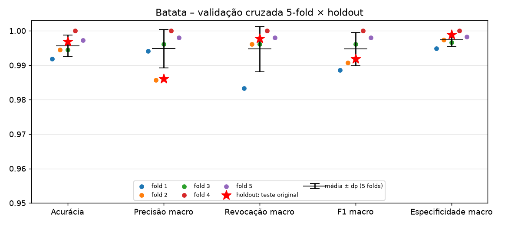

# PjBL2 – Classificadores de doenças de folhas (batata, milho e tomate)

Entrega do PjBL2 (Sistemas de Informação Inteligentes, PUCPR): um modelo de visão computacional com **≥ 3 categorias**, protocolo **treino/validação/teste**, **matriz de confusão** e métricas de classificação.
- A **batata** (3 classes) é a entrega principal.
- **Milho** (4 classes) e **tomate** (10 classes) seguem exatamente o mesmo procedimento (Quadros 1 e 3 do plano de projeto).

## 0. Onde está cada coisa (e como isto se relaciona com o notebook do Ítalo)
| Arquivo | Papel |
|---|---|
| `notebooks/01_treino_culturas.ipynb` + `notebooks/gerar_notebook.py` | **Notebook principal de treino da equipe** (Ítalo), para o Google Colab, com as 3 culturas. Não foi alterado. |
| `notebooks/execucao/{batata,milho,tomate}.ipynb` | **Execuções reais**, com saídas salvas, que **geraram os modelos e as métricas versionados em `modelos/`**. Foram executados ponta a ponta em CPU. São gerados por `notebooks/execucao/gerar_notebooks.py`. |
| `notebooks/execucao/batata_kfold.ipynb` | Validação cruzada **5-fold** da batata (complementar; o teste original fica de fora). Gerado por `notebooks/execucao/gerar_notebook_kfold.py`. Resultados em `modelos/kfold_batata.json` e `modelos/kfold_batata.png`. |
| `scripts/baixar_dados.sh` | Baixa o PlantVillage `color` (commit fixo) das 3 plantas. |
| `scripts/preparar_dados.py` | Divisão 70/15/15 (semente 42) por planta. Também gera `modelos/<planta>.classes.json`. |
| `scripts/especificidade.py` | Especificidade por classe (um-contra-todos) e macro, a partir das matrizes de confusão de teste salvas. |
| `dados/splits/<planta>/` | Listas fixas de treino, validação e teste (CSV) e as contagens. |
| `modelos/<planta>.onnx` | Modelos finais (saída = logits), no formato lido por `app/inferencia.py`. |
| `modelos/<planta>.classes.json` | `{"classes": [...]}` na ordem das saídas. É lido por `app/inferencia.py`. |
| `modelos/metricas_<planta>.json` | Métricas de teste, matriz, limiar calibrado, hiperparâmetros e histórico por época. |
| `modelos/matriz_confusao_<planta>.png`, `modelos/curvas_treino_<planta>.png` | Figuras. |

**Os dois notebooks seguem o mesmo protocolo:** PlantVillage `color`, ordem alfabética (`sorted`) das classes, divisão estratificada 70/15/15 com `seed=42`, MobileNetV2 da ImageNet em 2 fases, pesos de classe, aumento de dados só no treino e exportação ONNX com `input`/`logits`.

Diferenças das execuções em `notebooks/execucao/`:
- A divisão sai de listas CSV fixas, e duplicatas exatas (MD5) ficam no mesmo conjunto.
- O ajuste fino abrange só os últimos 5 blocos.
- O limiar é calibrado na validação.
- O treino do tomate tem um limite de imagens por classe (ver §3).

O notebook do Ítalo pode ser rodado no Colab para conferência. Os números deste documento vêm de `notebooks/execucao/`.

## 1. Base de imagens
- **Fonte:** PlantVillage (Hughes; Salathé, 2015), <https://github.com/spMohanty/PlantVillage-Dataset>, pasta `raw/color` (commit `7f7ecc7`).
- Usamos só a pasta `color` (imagens de 256×256 px). `grayscale` e `segmented` são versões das mesmas folhas.
- As imagens **não são versionadas**: estão no `.gitignore` e são baixadas por `bash scripts/baixar_dados.sh`.

| Planta | Classes | Imagens | Desbalanceamento |
|---|---|---|---|
| Batata | 3 | 2.152 | healthy: 152; doenças: 1.000 cada |
| Milho | 4 | 3.852 | 513 (cercosporiose) a 1.192 (ferrugem) |
| Tomate | 10 | 18.160 | 373 (mosaico) a 5.357 (TYLCV); 14 pares de imagens idênticas, mantidos juntos |

## 2. Protocolo experimental (igual para as 3 plantas)
- A divisão é **estratificada 70/15/15**, com **semente 42**, feita **por planta** e **antes** do aumento de dados.
- Imagens idênticas (mesmo MD5) ficam no mesmo conjunto.
- **Treino** ajusta os pesos. **Validação** escolhe a melhor época (maior F1 macro) e calibra o limiar. **Teste** é usado **uma única vez**, no final, com **todas** as imagens de teste.

| Planta | Treino (divisão) | Treino usado | Validação | Teste |
|---|---|---|---|---|
| Batata | 1.506 | 1.506 | 323 | 323 |
| Milho | 2.696 | 2.696 | 578 | 578 |
| Tomate | 12.712 | **7.227** (máx. 800/classe) | 2.724 | 2.724 |

## 3. Modelo e hiperparâmetros (iguais para as 3 plantas)
- **Arquitetura:** MobileNetV2 com pesos da ImageNet. A última camada vira `Dropout(0.2)` e `Linear(1280 → nº de classes)`.
- **Etapa 1:** backbone congelado, 6 épocas, Adam com lr 1e-3.
- **Etapa 2:** ajuste fino leve dos últimos 5 blocos convolucionais, 6 épocas, Adam com lr 1e-4.
- **Demais:** lote 32, weight decay 1e-4, BatchNorm congelado, entrada de 224×224 com normalização da ImageNet.
- **Pesos de classe:** inverso da frequência no treino usado.
- **Aumento de dados (só no treino):** recorte/zoom de 80–100%, espelhamentos, rotação de ±20° e variação de brilho, contraste e saturação.
- **Limite no tomate:** por tempo de CPU (8 núcleos, sem GPU), o treino do tomate usou **no máximo 800 imagens por classe**.
  - O sorteio usa semente 42 e é feito pelo `preparar_dados.py` **depois** da divisão (arquivo `treino_limitado.csv`).
  - Validação e teste **não** foram reduzidos e nenhuma imagem foi filtrada com base em previsões.
  - Com GPU, basta trocar o arquivo de treino para `treino.csv` para usar todas as imagens.
- **Tempo de execução (CPU):** batata 4,5 min, milho 8,7 min, tomate 28,2 min.

## 4. Resultados no conjunto de teste

### Resumo
| Planta | Acurácia | Precisão macro | Revocação macro | Especificidade macro | **F1 macro** | Pior classe (F1) | Menor especificidade | Limiar calibrado |
|---|---|---|---|---|---|---|---|---|
| Batata | 0,9969 | 0,9861 | 0,9978 | 0,9989 | **0,9918** | healthy (0,9787) | healthy (0,9967) | 0,98 |
| Milho | 0,9706 | 0,9647 | 0,9526 | 0,9904 | **0,9579** | Cercospora (0,8904) | Northern Leaf Blight (0,9721) | 0,69 |
| Tomate | 0,9482 | 0,9504 | 0,9357 | 0,9942 | **0,9402** | Early blight (0,8550) | ácaro-rajado (0,9786) | 0,63 |

**Especificidade** (Aula 03, p. 29): **Especificidade = VN / (VN + FP)**, ou seja, das imagens que **não** eram da classe, quantas o modelo **não** rotulou como ela.
- Com mais de duas classes, ela é calculada **um-contra-todos**: cada classe é tratada como "positiva" e as demais como "negativas", a partir da matriz de confusão de teste. A **especificidade macro** é a média simples entre as classes.
- O cálculo é feito por `scripts/especificidade.py`, sem retreino, e é salvo em `modelos/metricas_<planta>.json` (`teste.por_classe.<classe>.especificidade` e `teste.especificidade_macro`).
- A menor especificidade aponta a classe que mais "atrai" erros de outras. Exemplos: Northern Leaf Blight recebe os casos de cercosporiose no milho, e o ácaro-rajado recebe os de Target Spot e Early blight no tomate.
- Revocação (sensibilidade) e especificidade se complementam: uma mede se o modelo **encontra** a doença; a outra, se ele **não inventa** a doença.

### Batata (3 classes)
| Classe | Precisão | Revocação (sensibilidade) | Especificidade | F1 | Suporte |
|---|---|---|---|---|---|
| Early blight | 1,0000 | 1,0000 | 1,0000 | 1,0000 | 150 |
| Late blight | 1,0000 | 0,9933 | 1,0000 | 0,9967 | 150 |
| healthy | 0,9583 | 1,0000 | 0,9967 | 0,9787 | 23 |
| **Macro** | **0,9861** | **0,9978** | **0,9989** | **0,9918** | 323 |

Houve 1 erro: uma folha com requeima classificada como saudável, com confiança de 0,886.


### Milho (4 classes)
| Classe | Precisão | Revocação (sensibilidade) | Especificidade | F1 | Suporte |
|---|---|---|---|---|---|
| Cercospora leaf spot / Gray leaf spot | 0,9420 | 0,8442 | 0,9920 | 0,8904 | 77 |
| Common rust | 1,0000 | 1,0000 | 1,0000 | 1,0000 | 179 |
| Northern Leaf Blight | 0,9226 | 0,9662 | 0,9721 | 0,9439 | 148 |
| healthy | 0,9943 | 1,0000 | 0,9975 | 0,9971 | 174 |
| **Macro** | **0,9647** | **0,9526** | **0,9904** | **0,9579** | 578 |

A principal confusão é entre **cercosporiose e helmintosporiose**: 12 de 77 casos de cercosporiose foram previstos como Northern Leaf Blight. As duas são manchas foliares alongadas e parecidas.


### Tomate (10 classes)
| Classe | Precisão | Revocação (sensibilidade) | Especificidade | F1 | Suporte |
|---|---|---|---|---|---|
| Bacterial spot | 0,9215 | 0,9561 | 0,9892 | 0,9385 | 319 |
| Early blight | 1,0000 | 0,7467 | 1,0000 | 0,8550 | 150 |
| Late blight | 0,9676 | 0,9406 | 0,9963 | 0,9539 | 286 |
| Leaf Mold | 0,9854 | 0,9441 | 0,9992 | 0,9643 | 143 |
| Septoria leaf spot | 0,9110 | 0,9624 | 0,9898 | 0,9360 | 266 |
| Spider mites (ácaro-rajado) | 0,8251 | 0,9960 | 0,9786 | 0,9025 | 251 |
| Target Spot | 0,9167 | 0,8863 | 0,9932 | 0,9012 | 211 |
| Yellow Leaf Curl Virus | 0,9936 | 0,9689 | 0,9974 | 0,9811 | 803 |
| Mosaic virus | 1,0000 | 0,9643 | 1,0000 | 0,9818 | 56 |
| healthy | 0,9834 | 0,9916 | 0,9984 | 0,9875 | 239 |
| **Macro** | **0,9504** | **0,9357** | **0,9942** | **0,9402** | 2.724 |

As classes mais fracas:
- **Early blight** tem revocação de 0,75: é confundida com septoriose, requeima e ácaro.
- **Target Spot** é confundida com ácaro (21 casos).
- **Ácaro-rajado** tem a menor precisão (0,83), porque "absorve" erros de outras classes.

O F1 macro de validação do tomate subiu de 0,86 (fim da etapa 1) para 0,94 (época 11) sem estabilizar: com mais épocas ou com o treino completo (GPU), o tomate deve melhorar (ver §9.1).


As curvas de treino estão em `modelos/curvas_treino_<planta>.png`.

### Validação cruzada 5-fold na batata (Aula 03, p. 26)
O *holdout* acima mede o desempenho em **uma** divisão dos dados. Para saber se esse número depende da "sorte" da divisão, repetimos o treino da batata com **validação cruzada estratificada em 5 partes (5-fold)**. Os arquivos são `notebooks/execucao/batata_kfold.ipynb` (executado, gerado por `gerar_notebook_kfold.py`), `modelos/kfold_batata.json` e `modelos/kfold_batata.png`.

**Protocolo:**
- **Teste original fora:** os 15% de teste (323 imagens) ficaram **de fora e intocados**. Continuam sendo o *holdout* final, usado uma única vez, e o notebook confere que nenhuma imagem do teste entra nos folds.
- **Folds:** treino + validação (1.829 imagens, 85%) foram divididos em 5 folds estratificados com semente 42. Imagens com o mesmo MD5 ficam no mesmo fold.
- **Treino de cada fold:** 4 folds treinam (cerca de 1.463 imagens) e 1 fold valida (cerca de 366). A receita é **a mesma** do *holdout*, com as **12 épocas completas** (6 + 6), sem redução:
  - MobileNetV2 da ImageNet em 2 etapas;
  - aumento de dados só nos folds de treino;
  - pesos de classe calculados em cada fold de treino;
  - melhor época escolhida pelo F1 macro no fold de validação.
- **Tempo:** 29,1 min em CPU (8 threads), de 4,3 a 8,4 min por fold.

| Fold | Melhor época | Acurácia | Precisão macro | Revocação macro | F1 macro | Especificidade macro |
|---|---|---|---|---|---|---|
| 1 | 8 | 0,9918 | 0,9942 | 0,9833 | 0,9886 | 0,9949 |
| 2 | 12 | 0,9945 | 0,9857 | 0,9961 | 0,9908 | 0,9973 |
| 3 | 9 | 0,9945 | 0,9961 | 0,9961 | 0,9961 | 0,9966 |
| 4 | 12 | 1,0000 | 1,0000 | 1,0000 | 1,0000 | 1,0000 |
| 5 | 12 | 0,9973 | 0,9981 | 0,9980 | 0,9980 | 0,9983 |
| **Média ± dp** | — | **0,9956 ± 0,0031** | **0,9948 ± 0,0055** | **0,9947 ± 0,0066** | **0,9947 ± 0,0049** | **0,9974 ± 0,0019** |
| *Holdout* (teste original) | 12 | 0,9969 | 0,9861 | 0,9978 | 0,9918 | 0,9989 |



**O que a validação cruzada mostra:**
- **O modelo é estável entre divisões.** A acurácia varia de 0,992 a 1,000 entre os 5 folds (desvio-padrão 0,003) e o F1 macro de 0,989 a 1,000 (dp 0,005). Nenhum fold foi muito pior que os outros.
- **Concorda com o *holdout*.** A acurácia, a revocação, o F1 macro e a especificidade do teste original caem dentro da faixa média ± dp dos folds, então o resultado entregue não foi uma divisão "de sorte".
- **A precisão macro do *holdout* (0,986) fica um pouco abaixo da faixa.** No teste há uma única folha com requeima prevista como saudável, e a classe saudável tem só 23 imagens: um erro derruba a precisão dessa classe para 0,958 e puxa a média macro. Nos folds acontece o mesmo efeito (folds 1 e 2, F1 da classe saudável em 0,98). É a limitação de "classes pequenas" (§7), e não instabilidade do modelo.
- **Os erros são poucos e do mesmo tipo.** Somando os 5 folds, cada imagem foi avaliada uma vez por um modelo que não a viu no treino. Foram **8 erros em 1.829 imagens** (0,44%): 6 entre pinta-preta e requeima e 2 envolvendo a classe saudável. No *holdout* foi 1 erro em 323 (0,31%).
- **Escolher a época pela validação importa (§9.2).** Também medimos a **última época (12)**, sem nenhuma escolha. Nela a média cai para F1 0,9846 ± 0,0184. No fold 1, a melhor época foi a 8 (F1 0,989) e a última deu 0,955: o ajuste fino oscilou no fim, e guardar a melhor época evitou essa queda.
- **Leitura honesta:** o fold que escolhe a época é o mesmo que mede as métricas, o que deixa a média de 0,9947 levemente otimista. A estimativa independente continua sendo o teste original. A validação cruzada avalia a **receita** de treino (5 modelos); o modelo entregue (`batata.onnx`) é o do *holdout*, que não foi alterado.
- **Escopo:** a validação cruzada foi feita só na batata. No tomate ela custaria cerca de 5 × 28 min em CPU.

## 5. Limiar de confiança (calibrado na validação) × app
- **Regra (a mesma nas 3 plantas):** entre os limiares com cobertura ≥ 97% na validação, escolhe-se o de maior acurácia das fotos aceitas; em caso de empate, o maior.
- **Resultado:** batata **0,98**, milho **0,69**, tomate **0,63**.
- **No app:** o app usa um limiar único, **0,70** (`Form(0.70)` em `app/main.py`).

| Planta | Limiar | Cobertura no teste | Acurácia das aceitas | Observação |
|---|---|---|---|---|
| Batata | 0,98 (calibrado) | 96,6% | 100% | o único erro é rejeitado |
| Batata | 0,70 (app) | 99,7% | 99,7% | o erro passaria como "saudável" |
| Milho | 0,70 (app) | 96,7% | 98,0% | próximo do calibrado (0,69) |
| Tomate | 0,70 (app) | 96,0% | 96,9% | próximo do calibrado (0,63) |

(As linhas do milho e do tomate foram calculadas com o pré-processamento do app.)

**Sugestão para o TDE2:** usar um limiar por planta, lido de `modelos/metricas_<planta>.json`. Isso não foi alterado no app.

## 6. Compatibilidade com o app (`app/inferencia.py` da `main`)
- **Classes:** `modelos/<planta>.classes.json` tem o formato `{"planta": ..., "classes": [...]}`, na ordem alfabética das pastas. É a mesma ordem de `CLASSES_PADRAO` (que usa `sorted`) e do notebook do Ítalo.
- **Saídas:** o número de saídas de cada ONNX bate com o número de classes (3, 4 e 10), e a entrada se chama `input`.
- **Teste com o próprio app:** usei `carregar_modelo` e `classificar_foto` do app nas imagens de teste de cada planta. A acurácia ficou em **0,9969** (batata), **0,9689** (milho) e **0,9548** (tomate).
  - A pequena diferença em relação ao notebook (0,9969 / 0,9706 / 0,9482) vem do filtro de redimensionamento.
  - O app usa `Image.BILINEAR`; a avaliação nos notebooks de execução usou o padrão do PIL (bicúbico).
  - O treino usou o redimensionamento bilinear do torchvision, por isso o bilinear do app funciona bem.
- **Verificação ONNX × PyTorch** (todas as imagens de teste, pré-processamento do app): mesma classe em 100% dos casos; diferença máxima de probabilidade de 3,5e-6.

## 7. Limitações
- **Fotos de laboratório:** fundo uniforme e uma folha por foto. Em fotos de campo o desempenho tende a cair muito (Mohanty et al., 2016). **Ainda falta avaliar fotos reais externas** de cada planta e reportar separadamente.
- **Mesma folha em várias fotos:** a base não identifica a folha de origem. Fotos parecidas da mesma folha podem ter caído em conjuntos diferentes, o que pode deixar as métricas otimistas.
- **Classes pequenas:** batata healthy (23 imagens no teste) e tomate mosaico (56) têm métricas mais incertas.
- **Ácaro-rajado** é uma praga, não uma doença.
- **Escopo:** cada modelo só reconhece as classes em que foi treinado. Outras doenças, deficiências nutricionais ou fotos que não sejam de folha serão classificadas, erroneamente, em uma delas.

## 8. Como reproduzir
```bash
python -m venv .venv && source .venv/bin/activate
pip install --index-url https://download.pytorch.org/whl/cpu torch torchvision   # ou versão com GPU
pip install -r requirements-treino.txt
bash scripts/baixar_dados.sh                 # batata, milho e tomate (~440 MB)
python scripts/preparar_dados.py             # divisões 70/15/15 (semente 42) + modelos/<planta>.classes.json
cd notebooks/execucao
for p in batata milho tomate; do jupyter nbconvert --to notebook --execute --inplace $p.ipynb; done
jupyter nbconvert --to notebook --execute --inplace batata_kfold.ipynb   # validação cruzada 5-fold (≈ 30 min em CPU)
cd ../.. && python scripts/especificidade.py   # especificidade por classe e macro (Aula 03, p. 29)
```

## 9. Para a defesa de autoria: ligação com as aulas

### 9.1 Viés × variância (Aula 03, p. 27–28) nas nossas curvas
Nos slides, **viés** é a "flexibilidade do modelo em aprender com os dados" e **variância** é a "generalidade do modelo para reduzir erros nos testes":
- Viés alto (*underfitting*) é um modelo rígido demais, que não aprende nem os dados de treino.
- Variância alta (*overfitting*) é um modelo que decora o treino e erra em dados novos.

Nas nossas curvas (`modelos/curvas_treino_<planta>.png`; os números estão em `historico` nos JSON de métricas):

| Planta | Acurácia de validação no fim da etapa 1 (só a cabeça) | Melhor acurácia de validação na etapa 2 (ajuste fino) | Melhor época |
|---|---|---|---|
| Batata | 0,972 (época 6) | 1,000 (época 12) | 12 |
| Milho | 0,953 (época 6) | 0,974 (época 12) | 12 |
| Tomate | 0,891 (época 6) | 0,953 (época 11; F1 macro 0,941) | 11 |

- **Etapa 1 = viés mais alto.** Com as camadas convolucionais congeladas, só a camada densa final aprende. No tomate (10 classes), a validação estaciona perto de 0,89: o modelo é rígido demais para separar doenças parecidas.
- **Etapa 2 = menos viés.** Descongelar os últimos blocos dá mais flexibilidade ao modelo e a validação sobe para 0,95 (tomate), 0,97 (milho) e 1,00 (batata).
- **Variância baixa (sem *overfitting* forte).** A perda de validação acompanha a de treino; ela não dispara para cima enquanto a de treino cai, que é o padrão de sobreajuste mostrado na Aula 04, p. 41–42. Na época escolhida, a diferença entre treino e validação é pequena: tomate 0,955 × 0,953; milho 0,965 × 0,974.
- **Por que a perda de validação às vezes fica abaixo da de treino?** No treino, as imagens passam por aumento de dados e *dropout*, o que as torna mais difíceis. Na validação, as imagens são limpas e o *dropout* fica desligado.
- **Queda na época 7 nas três plantas.** É o início do ajuste fino: ao descongelar camadas, os pesos se reajustam e a perda sobe por um instante, depois cai.
- **Oscilações no fim** (tomate: perda de validação 0,140 → 0,203 → 0,151 nas épocas 9–11; milho: 0,097 → 0,143 nas épocas 10–11) mostram por que não se deve simplesmente ficar com a última época (§9.2).
- **Conclusão para o tomate:** o erro que sobra vem mais de **viés** do que de variância. Usamos menos épocas e no máximo 800 imagens por classe (§3), e Early blight, Target Spot e ácaro ainda se confundem. Mais épocas ou o treino completo com GPU devem ajudar.

### 9.2 Escolher a melhor época na validação = parada antecipada (Aula 04, p. 40–42)
A Aula 04 ("Quando devemos parar?") mostra que minimizar o erro de **treino** é perigoso: a partir de certo ponto, o erro de **validação** volta a subir. O certo é parar onde a validação é melhor.
- **Como fizemos:** treinamos um número fixo de épocas (6 + 6). A cada época medimos o **F1 macro na validação** e guardamos uma cópia dos pesos sempre que ele melhora. No fim, **restauramos a melhor época** (batata 12, milho 12, tomate 11).
- **Equivalência:** o resultado é o mesmo da parada antecipada com "paciência" até o fim do treino. O modelo final é o do ponto de melhor generalização, mesmo que as épocas seguintes piorem.
- **O teste fica de fora:** ele não participa dessa escolha. É usado uma única vez, depois.

### 9.3 Por que 70/15/15 e não o *holdout* 65/35 (Aula 03, p. 25–26)
O *holdout* dos slides divide a base em **treino (65%)** e **teste/validação (35%)**. Nós precisamos de **três** papéis separados:
1. **Treino (70%):** ajusta os pesos.
2. **Validação (15%):** é onde **tomamos decisões**. Escolhemos a melhor época (§9.2) e calibramos o limiar de confiança (§5).
3. **Teste (15%):** avalia o modelo final **uma única vez**.

Se escolhêssemos a época ou o limiar olhando o teste, a informação do teste "vazaria" para o modelo e as métricas sairiam otimistas. Com 15% para cada conjunto, o teste ainda tem 323 (batata), 578 (milho) e 2.724 (tomate) imagens.

A divisão é **estratificada**, mantendo a proporção de cada classe, e usa **semente fixa** (42), o que a torna reprodutível. A **validação cruzada (k-fold)** da Aula 03, p. 26 foi feita **na batata** como complemento: 5 folds sobre os 85% de treino + validação, com o teste original intocado (§4, "Validação cruzada 5-fold na batata"). Ela deu F1 macro 0,9947 ± 0,0049, coerente com o *holdout* (0,9918). Não substitui o *holdout*: ela avalia a estabilidade da receita, e o teste avalia o modelo entregue. No milho e no tomate ela não foi feita por tempo de CPU (no tomate, cerca de 5 × 28 min).

### 9.4 As camadas da CNN da Aula 05 dentro da MobileNetV2
A Aula 05 (p. 13–32) apresenta a CNN como **convolução → ReLU → pooling → flatten → rede densa**. Ela chama a parte convolucional de "pré-processamento" (extrai características) e a parte densa de classificador. Na MobileNetV2 (`torchvision`, 19 blocos em `features` + `classifier`):

| Conceito da aula | Onde está na MobileNetV2 | Observação |
|---|---|---|
| Imagem RGB (p. 14–15) | Entrada 224×224×3. Os valores 0–255 são divididos por 255 e padronizados (média e desvio da ImageNet; Aula 02, p. 13–14) | Mesmo pré-processamento no app |
| **Convolução + kernels** (p. 19–24) | Bloco 0: convolução 3×3 com 32 filtros. Blocos 1–17: "inverted residual", cada um com convolução 1×1 (expande), 3×3 *depthwise* (um filtro por canal) e 1×1 (projeta). Bloco 18: convolução 1×1 até 1280 canais | Os kernels (detectores de bordas, texturas, manchas) já vêm **aprendidos na ImageNet** |
| **Padding** (p. 22–23) | As convoluções 3×3 usam *padding* para manter o tamanho | — |
| **ReLU** (p. 25–26; Aula 04, p. 28) | **ReLU6** (a ReLU limitada em 6) depois das convoluções de expansão e *depthwise* | A projeção 1×1 é linear ("gargalo linear") |
| **Pooling** (p. 27–31) | A rede reduz a imagem com **convoluções de passo (*stride*) 2**, de 224 até 7×7. No final, um **pooling médio global** transforma 7×7×1280 em 1280 | Faz o mesmo papel do *max pooling* da aula: reduzir a dimensão e destacar características |
| **Flatten** (p. 32) | Depois do pooling global, o mapa vira um **vetor de 1280** | — |
| **Rede densa** (p. 13; Aula 04) | Nossa cabeça: `Dropout(0,2)` + `Linear(1280 → nº de classes)`. O **softmax** transforma a saída em probabilidades (aplicado no app) | É a camada que **trocamos** (1000 classes da ImageNet → 3, 4 ou 10) |

**Transferência de aprendizado em 2 etapas:**
1. **Etapa 1:** congelamos toda a parte convolucional e treinamos só a **rede densa** final. É um MLP (Aula 04) usando as características extraídas pela CNN.
2. **Etapa 2:** descongelamos também os **últimos 5 blocos convolucionais** (blocos 14–18; com a cabeça, cerca de 1,69 M dos 2,24 M parâmetros no tomate) com taxa de aprendizado 10× menor (1e-4). Assim os detectores de alto nível se ajustam a manchas e lesões de folha, sem destruir o que foi aprendido na ImageNet.
3. **Treino:** a rede é treinada por *backpropagation* com descida do gradiente (Adam), como na Aula 04, p. 30–39. A perda é a entropia cruzada ponderada pelos pesos de classe.

### 9.5 Técnicas das aulas que **não** se aplicam a este problema
- **Método do cotovelo / "joelho" (agrupamento, Aula 02):** serve para escolher o **número de grupos *k*** no K-Means, no ponto em que a curva de erro intra-grupo "dobra". Os slides usam, para a mesma pergunta, o corte do dendrograma (p. 30) e a silhueta (p. 32). Nosso problema é **supervisionado**: as classes já são conhecidas e rotuladas (3, 4 ou 10), então não há *k* a escolher. O que escolhemos com uma curva é a **época** (§9.2), e pelo F1 na validação, não por cotovelo.
- **Raiz da árvore / ganho de informação (Aula 03, p. 11):** numa árvore de decisão, a **raiz** é o atributo com maior **ganho de informação**, por exemplo "Precipitação" ou "Velocidade". Esse critério vale para dados tabulares com poucos atributos interpretáveis. Nossa entrada são cerca de 150 mil valores de pixel (224×224×3), e as características são **aprendidas** pelas convoluções, não escolhidas por ganho de informação. Por isso não usamos árvore de decisão. Uma comparação possível, mas fora do escopo, seria treinar uma árvore ou SVM sobre o vetor de 1280 características da MobileNetV2.

## Referências
- HUGHES, D. P.; SALATHÉ, M. *An open access repository of images on plant health…* arXiv:1511.08060, 2015.
- MOHANTY, S. P.; HUGHES, D. P.; SALATHÉ, M. *Using deep learning for image-based plant disease detection.* Frontiers in Plant Science, 7:1419, 2016.
- SANDLER, M. et al. *MobileNetV2: inverted residuals and linear bottlenecks.* CVPR, 2018.
